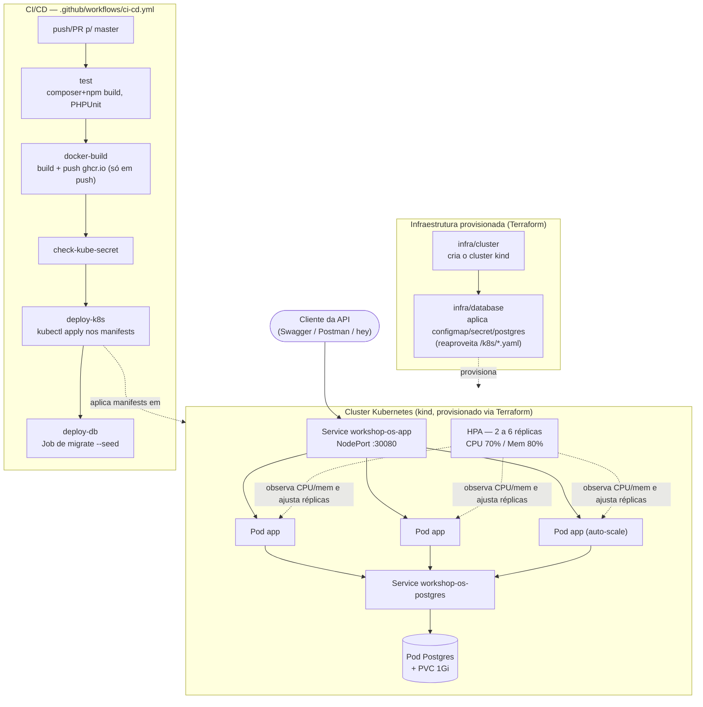
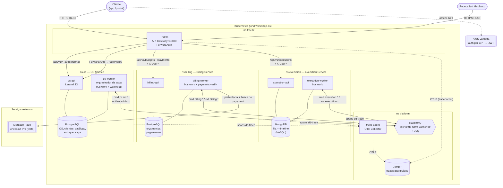

# 15SOAT - Tech Challenge — OS Service (Fases 1–4)

[](https://github.com/CandidoRPNeto/15SOAT-Fase1/actions/workflows/ci-cd.yml)

API RESTful para gestão de ordens de serviço (OS) de uma oficina mecânica.
Na Fase 4 este repositório é o **OS Service** e o **orquestrador da saga**
entre os microsserviços (ver seção Fase 4).

---

## Stack

| Camada       | Tecnologia                        |
|--------------|-----------------------------------|
| Linguagem    | PHP `^8.3` (imagem Docker/CI usa 8.4) |
| Framework    | Laravel 13                        |
| Banco        | PostgreSQL 16 (produção/Docker/K8s) |
| Banco testes | SQLite `:memory:`                 |
| Auth         | Laravel Sanctum (API tokens) + JWT RS256 (Fase 3, CPF — `firebase/php-jwt`) |
| Docs         | L5-Swagger / OpenAPI 3            |
| Fila         | Database driver                   |
| Container    | Docker (multi-stage)              |
| Orquestração | Kubernetes local (`/k8s`, referência — [ADR-003](docs/architecture/adrs/adr-003-keep-local-k8s-reference.md)) + Dokploy (cloud, Fase 3 — [ADR-001](docs/architecture/adrs/adr-001-dokploy-as-cloud.md)) |
| IaC          | Terraform (`/infra` local; `15SOAT-Fase1-*` cloud, Fase 3) |
| CI/CD        | GitHub Actions (`.github/workflows/ci-cd.yml`) |
| Observabilidade | APM: biblioteca dd-trace na imagem → OpenTelemetry Collector → Jaeger, trace distribuído por HTTP, outbox e RabbitMQ. Métricas: Datadog Agent (DaemonSet) no cluster. Logs JSON com `correlation_id`/`saga_id` ([ADR-016](docs/architecture/adrs/adr-016-local-apm-jaeger.md)) |

---

## Fase 2 — objetivo desta evolução

A Fase 1 entregou o sistema inicial de gestão de OS, veículos, clientes e
estoque. A Fase 2 evolui essa aplicação para suportar crescimento — mais
unidades, mais volume de OS em horários de pico — sem perder qualidade:

- Refatoração para **Arquitetura Hexagonal leve** (`Domain` → `Application`
  → `Infrastructure`/`Http`), preservando as regras de negócio da Fase 1.
- Novas/alteradas APIs de OS: abertura com serviços/itens no mesmo payload,
  consulta rápida de status, aprovação de orçamento via webhook, listagem
  ordenada por prioridade de status, atualização de status via e-mail
  (stub).
- **Containerização, Kubernetes, Terraform e CI/CD** para suportar
  escalabilidade dinâmica e deploy automatizado.

### Componentes da aplicação

```
app/
├── Domain/
│   └── ServiceOrder/
├── Application/
│   ├── ServiceOrder/
│   └── Ports/
├── Infrastructure/
│   ├── Persistence/Eloquent/
│   └── Messaging/
├── Contracts/
├── Enums/ 
├── Http/
│   ├── Controllers/Api/V1/
│   ├── Middleware/
│   ├── Requests/
│   └── Resources/
├── Jobs/
├── Models/
├── Providers/ 
└── Services/
```

Regra de dependência: `Domain` não conhece Laravel/Eloquent; `Application`
orquestra casos de uso sobre `Domain` + `Ports`; `Infrastructure`/`Http`
implementam esses Ports e adaptam para fora (HTTP, banco). Integrações
externas (pagamento e mensageria) são **stubs** — contratos definidos via
interface, prontos para substituição por implementações reais.

### Infraestrutura provisionada

| Camada       | Onde                | O quê |
|--------------|---------------------|-------|
| Container    | `Dockerfile`         | Build multi-stage: `deps` (composer) → `frontend` (npm/vite) → `runtime` (imagem final enxuta) |
| Orquestração | `k8s/`               | Deployment + Service + ConfigMap + Secret + HPA da API, Deployment + Service + PVC do Postgres, Job de migração |
| IaC          | `infra/`             | Terraform: `infra/cluster` provisiona o cluster kind local; `infra/database` aplica os manifestos de banco/config reaproveitando os arquivos de `k8s/` |
| CI/CD        | `.github/workflows/` | Pipeline de build, testes, build+push da imagem e deploy no cluster |

### Desenho da arquitetura



Fluxo resumido: `push/PR → build (composer+npm) → test (PHPUnit, SQLite :memory:) → docker-build (build + push da imagem para ghcr.io, só em push p/ master) → deploy-k8s (kubectl apply: configmap, secret, postgres, deployment, service, hpa) → deploy-db (Job de migração + seed)`.

`deploy-k8s`/`deploy-db` só rodam com o secret `KUBE_CONFIG` configurado no repositório (cluster real e alcançável); sem isso, ficam `skipped` — o cluster kind local (seção seguinte) é a referência K8s literal desta fase (ver [`k8s/README.md`](k8s/README.md)); o deploy em nuvem vigente é definido na Fase 3, seção abaixo.

Detalhes de cada estágio em [`.github/workflows/ci-cd.yml`](.github/workflows/ci-cd.yml).

---

## Fase 4 — microsserviços + Saga Pattern

Requisitos: [`evolucao_fase4`](evolucao_fase4). Epics: [`spec.md`](spec.md).
Decisões: [RFC-004](docs/architecture/rfcs/rfc-004-microservices-split.md),
[ADR-010](docs/architecture/adrs/adr-010-saga-orchestration.md) a
[ADR-015](docs/architecture/adrs/adr-015-per-repo-messaging-lib.md).
Material do PDF: [`docs/fase4/entrega.md`](docs/fase4/entrega.md).



### Microsserviços

| Serviço | Repositório | Banco | Responsabilidade |
|---|---|---|---|
| **OS Service** | este repo | PostgreSQL | auth (Sanctum + JWT do Lambda), clientes, veículos, catálogo/estoque, abertura e histórico da OS, **orquestrador da saga** |
| **Billing Service** | [15SOAT-Fase1-billing](https://github.com/CandidoRPNeto/15SOAT-Fase1-billing) | PostgreSQL | orçamentos, aprovação, pagamentos (Mercado Pago) |
| **Execution Service** | [15SOAT-Fase1-execution](https://github.com/CandidoRPNeto/15SOAT-Fase1-execution) | MongoDB | fila de diagnóstico/reparo, timeline da execução |
| Plataforma | [15SOAT-Fase1-kubernetes](https://github.com/CandidoRPNeto/15SOAT-Fase1-kubernetes) | — | Traefik (gateway + ForwardAuth), RabbitMQ, scripts de deploy/demo, monitores Datadog |

Comunicação:
- **REST síncrono** via Traefik. O OS Service valida o token (`/api/v1/auth/verify`), e o gateway repassa `X-User-*` para Billing/Execution.
- **Assíncrono** via RabbitMQ: comandos `cmd.<serviço>.<verbo>` e eventos `evt.<serviço>.<fato>`, com outbox transacional e inbox idempotente.
- Nenhum serviço acessa o banco de outro.

### Saga Pattern — estratégia escolhida: **orquestrada**

O orquestrador (`App\Application\Saga`) roda no `os-worker`. Ele persiste o
estado em `saga_instances`/`saga_steps` e conduz o fluxo:

abrir OS → enfileirar diagnóstico → orçamento → aprovação + reserva de
estoque → enfileirar reparo → reparo (**pivot**) → pagamento → entrega.

**Por que orquestrada:**
- o fluxo é linear e tem um dono natural (a OS);
- um coordenador explícito mostra o estado da saga numa consulta (`GET /api/v1/service-orders/{id}/history`);
- concentra a compensação num lugar só;
- permite testar o fluxo inteiro com BDD.

Na coreografia, cada serviço precisaria conhecer as falhas dos outros, e o
fluxo ficaria espalhado em 3 repositórios.

**Rollback / compensação:**
- Cada passo compensável é desfeito em ordem reversa: libera o estoque, anula o orçamento (`cmd.billing.void_budget`), cancela a tarefa (`cmd.execution.cancel_task`) e cancela a OS.
- Gatilhos: estoque insuficiente, Billing/Execution recusando, rejeição do cliente ou timeout.
- `saga:watchdog` reenvia passos sem resposta (3×) e então compensa.
- Depois do pivot (início do reparo) só há retry.

Diagramas:
- [caminho feliz](docs/architecture/diagrams/fase4/saga-happy-path.png)
- [compensação](docs/architecture/diagrams/fase4/saga-compensation.png)
- [estados](docs/architecture/diagrams/fase4/saga-state-machine.png)
- [CI/CD](docs/architecture/diagrams/fase4/cicd-pipeline.png)
- [implantação K8s](docs/architecture/diagrams/fase4/k8s-deployment.png)

### Rodar a Fase 4 (Kubernetes local — kind `workshop-os`)

```bash
export KUBECONFIG=~/.kube/workshop-os-config
../15SOAT-Fase1-kubernetes/scripts/apply-platform.sh           # Traefik, RabbitMQ, Secrets
scripts/deploy-kind.sh ghcr.io/candidorpneto/15soat-fase1:latest  # este serviço (idem nos outros repos)
../15SOAT-Fase1-kubernetes/demo/e2e-saga.sh                     # fluxo completo pelos 3 serviços
../15SOAT-Fase1-kubernetes/demo/e2e-compensation.sh stock       # falha + compensação
```

### CI/CD

Pipeline independente em `.github/workflows/ci-cd.yml`:
1. **test** — unit, feature e BDD; cobertura ≥ 80%; RabbitMQ real;
2. **quality** — Pint + SonarCloud quality gate;
3. **build** — imagem no GHCR;
4. **deploy** — runner self-hosted → kind, com migrate + rollout + smoke test, só em push na `master` ([ADR-014](docs/architecture/adrs/adr-014-self-hosted-runner-kind.md)).

A branch `master` é protegida: PR obrigatório e checks automáticos.

### Testes, BDD e cobertura

- BDD: [`features/saga_ordem_de_servico.feature`](features/saga_ordem_de_servico.feature) (Gherkin pt-BR, 5 cenários: fluxo completo + 4 falhas). Roda no PHPUnit (`tests/Bdd`) via `behat/gherkin`, porque o Behat 3 não instala com Symfony 8.
- Cobertura medida no CI (PHPUnit + pcov, RabbitMQ real, gate `--min=80`):

  | Execução | Testes | Cobertura |
  |---|---|---|
  | [CI/CD run 44142008421 (PR #8)](https://github.com/CandidoRPNeto/15SOAT-Fase1/actions/runs/44142008421) | 170 (415 assertions; unit + feature + 5 cenários BDD) | **94,6%** |

  Relatório Clover: artefato `coverage` da execução. Local, sem broker: ~89%.
- Swagger: http://localhost:30080/api/documentation (Billing em `/billing/api/documentation`, Execution em `/execution/api/documentation`). Postman: [`Tech_Challenge.postman_collection.json`](Tech_Challenge.postman_collection.json), pasta "Fase 4 — Saga".

## Fase 3 — operação corporativa

Evolução para nível corporativo: API Gateway, autenticação via CPF emitindo
JWT a partir de uma Function Serverless, split em 4 repositórios com CI/CD
e branch protection próprios, banco gerenciado, observabilidade via
Datadog. Requisito original: `git show 91319ed:evolucao_fase3`.

**Status**: arquitetura, código e Terraform completos e validados
localmente (testes reais + `terraform validate` contra os providers reais
em todos os módulos); nenhum `terraform apply`/deploy real foi executado —
depende de credenciais de nuvem (Dokploy, AWS, Datadog) do usuário, não
compartilhadas nesta sessão de desenvolvimento. Ver o
[diagrama de componentes](docs/architecture/diagrams/components.md) pra
uma visão consolidada de nuvem × APIs × banco × monitoramento, com a
tabela de status por componente.

### Os 4 repositórios

| # | Repo | Conteúdo |
|---|------|----------|
| 1 | [`15SOAT-Fase1-lambda`](https://github.com/CandidoRPNeto/15SOAT-Fase1-lambda) | Lambda AWS (CPF → status do cliente → JWT) + API Gateway |
| 2 | [`15SOAT-Fase1-kubernetes`](https://github.com/CandidoRPNeto/15SOAT-Fase1-kubernetes) | Terraform: app + domínio + Datadog Agent/monitors |
| 3 | [`15SOAT-Fase1-database`](https://github.com/CandidoRPNeto/15SOAT-Fase1-database) | Terraform: Postgres gerenciado (Dokploy) |
| 4 | `15SOAT-Fase1` (este repo) | Aplicação Laravel + guard CPF/JWT + endpoint interno |

Detalhes da divisão em [ADR-002](docs/architecture/adrs/adr-002-four-repo-split.md).

### Decomposição e decisões

Epics da Fase 3 encerrados (ver [`history.md`](history.md)); Fase 4 em [`spec.md`](spec.md).
RFCs/ADRs completos em [`docs/architecture/`](docs/architecture/):
[RFC-001](docs/architecture/rfcs/rfc-001-cloud-strategy.md) (nuvem),
[RFC-002](docs/architecture/rfcs/rfc-002-managed-database-strategy.md) (banco),
[RFC-003](docs/architecture/rfcs/rfc-003-cpf-auth-strategy.md) (auth CPF),
ADR-001 a ADR-009. Diagramas de sequência:
[autenticação](docs/architecture/diagrams/sequence-auth.md),
[abertura de OS](docs/architecture/diagrams/sequence-service-order.md).

### Autenticação por CPF — testando localmente

Rota nova, fora de `/api/v1`, exclusiva do Lambda:

```bash
curl -X POST http://localhost:8000/internal/clients/cpf-lookup \
  -H "Content-Type: application/json" \
  -H "X-Internal-Api-Key: $LAMBDA_INTERNAL_API_KEY" \
  -d '{"cpf_cnpj": "111.444.777-35"}'
```

Rotas de `/api/v1` aceitam `Authorization: Bearer <jwt>` (RS256, emitido
pelo Lambda) além do token Sanctum de sempre — aditivo, não substitui o
login por email/senha (ver [RFC-003](docs/architecture/rfcs/rfc-003-cpf-auth-strategy.md)).

---

## Como rodar

### Execução local (Docker Compose)

> Necessário ter o Docker instalado na máquina.

```bash
docker compose up --build -d
```

O container sobe o banco, roda as migrations, popula os dados de demonstração e inicia o servidor.

| Recurso    | URL                                       |
|------------|-------------------------------------------|
| API        | http://localhost:8000/api/v1/             |
| Swagger UI | http://localhost:8000/api/documentation   |

### Deploy em Kubernetes

Fase 4: o OS Service roda no namespace `os` do cluster kind `workshop-os`,
atrás do Traefik da plataforma
([15SOAT-Fase1-kubernetes](https://github.com/CandidoRPNeto/15SOAT-Fase1-kubernetes)).

```bash
export KUBECONFIG=~/.kube/workshop-os-config
../15SOAT-Fase1-kubernetes/scripts/apply-platform.sh   # uma vez: Traefik, RabbitMQ, Secrets
docker build -t ghcr.io/candidorpneto/15soat-fase1:local .
scripts/deploy-kind.sh ghcr.io/candidorpneto/15soat-fase1:local
# http://localhost:30080 → Traefik → os-api
```

`scripts/deploy-kind.sh` faz o seguinte (o job `deploy` do CI roda o mesmo script):
1. `kind load` da imagem;
2. `kubectl apply -k k8s/`;
3. Postgres pronto;
4. Job de migração;
5. rollout de `os-api`/`os-worker`;
6. smoke test via gateway.

Detalhes em [`k8s/README.md`](k8s/README.md).

### Provisionamento da infraestrutura com Terraform

> Necessário ter Docker e Terraform `>= 1.5` instalados.

```bash
cd infra/cluster && terraform init && terraform apply   # cria o cluster kind
cd ../database   && terraform init && terraform apply   # aplica config/secret/postgres no cluster
```

Recursos criados por cada módulo, ordem de `destroy` e pré-requisitos em
[`infra/README.md`](infra/README.md).

---

## Testar a API

- **Postman**: importe [`Tech_Challenge.postman_collection.json`](Tech_Challenge.postman_collection.json)
  — inclui as APIs alteradas/criadas na Fase 2 (consulta de status, decisão
  de orçamento via webhook, abertura de OS com serviços/itens no payload).
- **Swagger/OpenAPI**: com a aplicação rodando, acesse
  **http://localhost:8000/api/documentation**.

---

## Teste de carga e escalabilidade automática

Dois scripts em [`scripts/`](scripts/) simulam consumo real da API contra o
cluster Kubernetes (NodePort `:30080`), para observar o HPA (`k8s/hpa.yaml`)
escalando de 2 para até 6 réplicas sob carga e voltando ao normal depois.

### `scripts/load-test.sh` — carga simples e sustentada

Login como recepcionista + criação de OS em loop via [`hey`](https://github.com/rakyll/hey):

```bash
./scripts/load-test.sh http://127.0.0.1:30080 50 90s   # BASE_URL, concorrência, duração
```

Em outro terminal, acompanhe o scaling: `kubectl get hpa workshop-os-app -w`.

### `scripts/route-load-test.js` — carga pelos 3 microsserviços (Fase 4)

Gera tráfego real via gateway para encher o Jaeger, o RabbitMQ e o HPA:

1. CRUD no OS Service (clientes, veículos, serviços, peças).
2. Sagas completas em paralelo: OS → diagnóstico (Execution) → orçamento (Billing) → reparo → pagamento → entrega. Cerca de 15% são rejeitadas pelo cliente e 15% compensam por falta de estoque.
3. Leituras nos 3 serviços (listas, detalhes, histórico da saga).

| Tier      | Sagas | CRUD | Leituras | Concorrência | Orçamento de tempo |
|-----------|-------|------|----------|--------------|--------------------|
| `light`   | 6     | 6x   | 10x      | 6            | 120 s              |
| `heavy`   | 40    | 60x  | 100x     | 20           | 600 s              |
| `extreme` | 150   | 300x | 500x     | 40           | 1200 s             |

```bash
node scripts/route-load-test.js light               # BASE_URL padrão: http://127.0.0.1:30080
node scripts/route-load-test.js heavy 30 300        # concorrência e orçamento (s) opcionais
node scripts/route-load-test.js extreme 40 0        # 0 = sem corte por tempo
```

- Use `127.0.0.1`, não `localhost`: o Node resolve `localhost` para `::1` (IPv6) primeiro, e o kind só expõe IPv4.
- As sagas usam peças criadas pelo próprio script. O estoque do seed (usado por `demo/e2e-saga.sh`) não é consumido.
- O script só apaga o que ele mesmo criou.
- Ao final, imprime o resultado das sagas e um resumo por rota (tentativas, `2xx`/`4xx`/`5xx`, latência média).
- Problema conhecido: sob concorrência, `ServiceOrder::generateNumber()` (conta os registros do ano para montar `OS-AAAA-NNNNN`) pode colidir e retornar `500`. O script retenta a criação da OS.

---

## Credenciais de demo

| Perfil        | E-mail                | Senha    | Pode fazer                                                               |
|---------------|-----------------------|----------|--------------------------------------------------------------------------|
| Recepcionista | recepcao@workshop.com | password | CRUD clientes/veículos, criar OS, entregar veículo após pagamento        |
| Mecânico      | mecanico@workshop.com | password | CRUD serviços/itens (estoque), criar OS, diagnóstico, execução, orçamento|
| Cliente       | carlos@example.com    | password | Consultar suas OSs, aprovar/cancelar orçamento, pagar OS                 |

---

## Fluxo de status da OS

```
received → in_diagnosis → awaiting_approval → approved → in_execution → finalized → delivered
   └──────────────┴──────────────┴──→ cancelled (compensação da saga)
```

Fase 4: a OS muda de status pelos eventos da saga (Execution/Billing), e não
por endpoints de transição. Notificações automáticas saem na criação, no
orçamento gerado, na finalização e no atraso da retirada (job horário).

---

## Endpoints principais

Todos os endpoints (exceto login) requerem o header:

```
Authorization: Bearer {token}
```

| Método | Rota                                          | Perfil                  | Descrição                                       |
|--------|-----------------------------------------------|-------------------------|-------------------------------------------------|
| POST   | `/api/v1/auth/login`                          | público                 | Login — retorna token Sanctum                   |
| POST   | `/api/v1/auth/logout`                         | autenticado             | Logout                                          |
| GET    | `/api/v1/auth/me`                             | autenticado             | Dados do usuário autenticado                    |
| GET    | `/api/v1/clients`                             | recepcionista/mecânico  | Listar clientes                                 |
| POST   | `/api/v1/clients`                             | recepcionista/mecânico  | Cadastrar cliente                               |
| GET    | `/api/v1/vehicles`                            | recepcionista/mecânico  | Listar veículos                                 |
| GET    | `/api/v1/services`                            | recepcionista/mecânico  | Listar serviços do catálogo (com itens)         |
| POST   | `/api/v1/services`                            | recepcionista/mecânico  | Cadastrar serviço (com lista de itens)          |
| GET    | `/api/v1/items`                               | recepcionista/mecânico  | Listar itens em estoque                         |
| POST   | `/api/v1/items`                               | recepcionista/mecânico  | Cadastrar item (`type`: `insumo` ou `peca`)     |
| PUT    | `/api/v1/items/{id}`                          | recepcionista/mecânico  | Atualizar item / ajustar estoque                |
| GET    | `/api/v1/service-orders`                      | todos                   | Listar OS — exclui finalizadas/entregues e ordena por prioridade de status (sem filtro `status`) |
| POST   | `/api/v1/service-orders`                      | recepcionista/mecânico  | Criar OS (aceita `services[]`/`items[]` já no payload) |
| GET    | `/api/v1/service-orders/{id}/status`          | todos                   | Consulta rápida da situação atual da OS         |
| POST   | `/api/v1/service-orders/{id}/services`        | mecânico                | Adicionar serviço (cria itens automaticamente)  |
| POST   | `/api/v1/service-orders/{id}/items`           | mecânico                | Adicionar item manualmente à OS                 |
| DELETE | `/api/v1/service-orders/{id}/items/{itemId}`  | mecânico                | Remover item da OS                              |
| GET    | `/api/v1/service-orders/{id}/history`         | todos                   | Histórico de status + passos da saga            |
| POST   | `/api/v1/service-orders/{id}/deliver`         | recepcionista           | Entregar veículo (OS finalizada e paga; conclui a saga) |
| GET    | `/api/v1/auth/verify`                         | autenticado             | Alvo do ForwardAuth do Traefik (headers `X-User-*`) |
| POST   | `/webhook/messaging`                          | público                 | Lista OS abertas                                |

Fase 4 — rotas nos outros serviços (mesmo host, via gateway):
- **Billing**: `GET /api/v1/budgets`, `POST /api/v1/budgets/{id}/approve|reject`, `GET /api/v1/payments`, `POST /api/v1/payments/{id}/verify`.
- **Execution**: `GET /api/v1/executions`, `POST /api/v1/executions/{id}/diagnosis|repair/start|finish`.

Documentação completa e interativa em **http://localhost:30080/api/documentation** (kind) ou http://localhost:8000/api/documentation (Docker Compose).

---

## Gestão de Itens na OS

Ao adicionar um serviço à OS, os itens necessários para executá-lo são criados automaticamente na lista de materiais da OS. O mecânico pode adicionar ou remover itens manualmente.

A resposta da OS inclui, para cada item:

| Campo               | Descrição                                  |
|---------------------|--------------------------------------------|
| `requested_quantity`| Quantidade necessária para a OS            |
| `total_quantity`    | Quantidade disponível em estoque           |

Isso permite ao frontend alertar o mecânico caso o estoque seja insuficiente antes de iniciar a execução.

---

## Testes

Rodar todos os testes:

```bash
composer run test
```

Rodar com relatório de cobertura no terminal + arquivos para o SonarQube:

```bash
XDEBUG_MODE=coverage php artisan test --coverage --coverage-clover=coverage.xml --log-junit=test-results.xml
```

**Resultado atual: 168 testes (unit + feature + 5 cenários BDD), 411 assertions; 2 testes de integração com RabbitMQ rodam quando `RABBITMQ_TEST_HOST` está definido (sempre no CI). Cobertura ~89%.**

---

## SonarQube

Sobe o SonarQube (consome ~2 GB de RAM):

```bash
docker compose --profile sonar up -d
```

Acesse em **http://localhost:9000** (login: `admin`).

Gere o `coverage.xml` e rode o scanner:

```bash
XDEBUG_MODE=coverage php artisan test --coverage-clover=coverage.xml --log-junit=test-results.xml

export SONAR_TOKEN=<seu_token>
docker compose --profile sonar run sonarscanner
```
